# UX and accessibility audit — 17 October 2026

Live review of **Omnichannel Orchestration Reference**, using the existing Chrome session at `http://localhost:5173/manager/`, brand **Grathaus Outdoor**, signed in as admin. Repository HEAD observed: `01e6992`; the checkout already contained unrelated local edits. The running app and demo data were live and some timestamps changed during the review; screenshots are individual observations, not an immutable build snapshot.

28 findings: 4 P1, 18 P2, 6 P3. P1 = major usability/accessibility barrier; P2 = meaningful issue; P3 = polish. These are audit priorities, not accepted backlog commitments.

[Open the visual screenshot report](report.html) · [Machine-readable findings](findings.json) · [Screen capture inventory](capture-manifest.json) · [Keyboard checks](keyboard-checks.json)

## Scope and limitations

Reviewed all nine main navigation sections and every Settings subsection, representative list/detail views, email and Push editors, preview and image-source dialogs, creation dialogs, audience rule editing, send planning, archived messages, and lower sections of long forms. Desktop viewport: **1456 × 755 CSS px**; responsive samples: **1024 × 768** and **390 × 844**. Screenshots include rendered text and accessible DOM snapshots; targeted source inspection corroborates selected findings.

This is a broad screen audit, not an assertion that every possible data/error state is covered. Approval inbox and decision history are empty, so request-detail/approve/reject and populated history states could not be visually tested. The sign-in route redirected the existing authenticated session; password and email-link steps were not reviewed. Failed/uncertain delivery recovery, permission-denied states, stale-save conflicts, AI-generated results, first-run states and every module type were not exercised. Dark mode, increased-contrast mode, screen-reader audio and all keyboard layouts were not tested. ARIA checks are DOM and interaction checks, not full assistive-technology certification.

No application code was changed, no record was created or saved, and no send, approval, AI request, credential or permission operation was performed. One unsaved creation input was typed for a keyboard test, then dismissed. The browser was returned to Approvals and the temporary viewport override was reset.

## Main patterns

- Highest priority: repair image-card height, standardize the two broken creation forms, untangle graph labels, and provide control over character shortcuts.
- Reuse shared card, field, modal-header and action-footer layouts: most spacing mistakes occur where individual screens diverge from them.
- Preserve the working keyboard foundations: list activation, menu arrows, Escape, input typing protection, focus return and focus wrapping passed in sampled flows.
- The linen/petrol/pale-pink palette itself is coherent. The measured color defect is a field-border token inconsistency, not a recommendation to replace the palette.

## Findings

### UX-01 · P1 · Image thumbnails overflow their buttons and overlap the filters

**Defect — Image picker / Library**

Each image button measures 28 px high while its image measures 96 px high. The images overlap adjacent rows and extend into the filter area; names and sizes are visually obscured. Reproduced at desktop and phone widths.

**Impact:** It is difficult to identify an asset or know which image a click will select.

**Suggested correction:** Give image cards intrinsic height, prevent flex shrinking of thumbnails, and reserve separate rows for thumbnail, name and dimensions. Keep the grid below the filters.

**Reproduce:** Open an email or Push variant → Change image… → Library.

**Source corroboration:** `frontend/src/index.css:155`; `frontend/src/index.css:1242`.

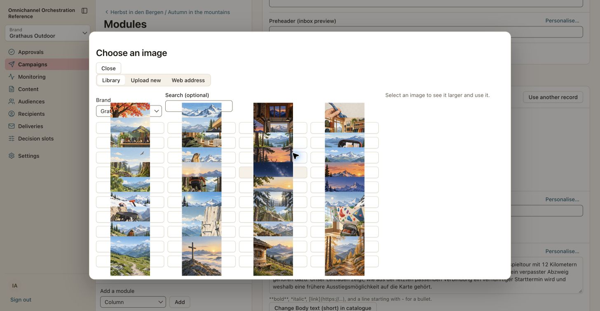

### UX-02 · P1 · New record and New audience use a broken horizontal form layout

**Defect — Create dialogs**

The heading and first field share a row; fields are only about 164 px wide. Help text wraps beside fields. New category, New campaign and Settings creation dialogs instead use a full-width vertical form.

**Impact:** The first input looks attached to the title; labels, fields and actions lack a reliable reading order visually.

**Suggested correction:** Use the same vertical dialog form and footer component as New category. Keep the heading outside the field layout.

**Reproduce:** Records → New record; compare Audiences → New audience and Categories → New category.

**Source corroboration:** `frontend/src/screens/ContentCreate.tsx:51`; `frontend/src/screens/AudienceCreate.tsx:54`; `frontend/src/index.css:758`.

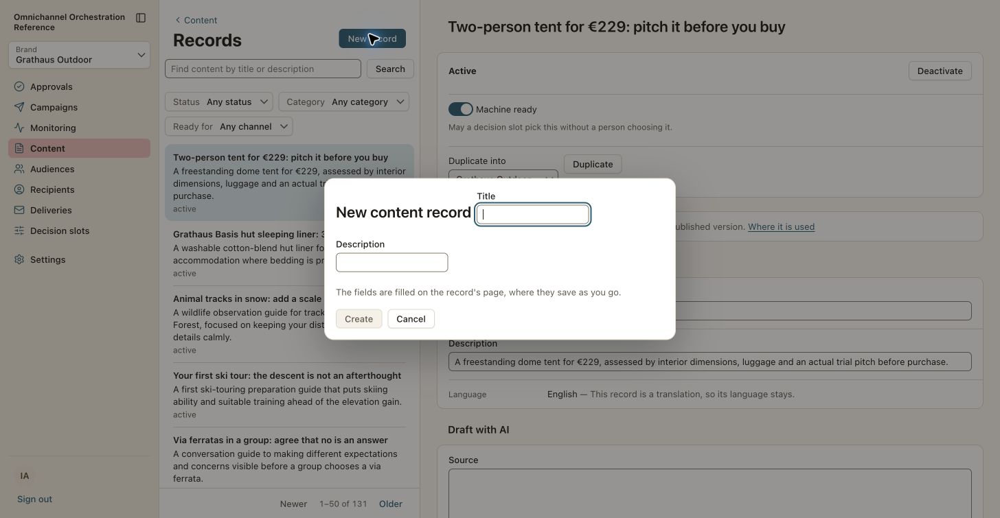

### UX-03 · P1 · Category graph labels collide with nodes and edges

**Defect — Content / Graph**

Multiple labels sit under adjacent circles or cross the dense edge bundle. Several category names are partially obscured.

**Impact:** The drawing does not reliably communicate category names or relationships. The accessible table helps but does not repair the visual graph.

**Suggested correction:** Separate labels from node geometry, reduce edge density until a category is selected, and add zoom or a focused neighborhood view.

**Reproduce:** Content → Graph, with the current 26-category dataset.

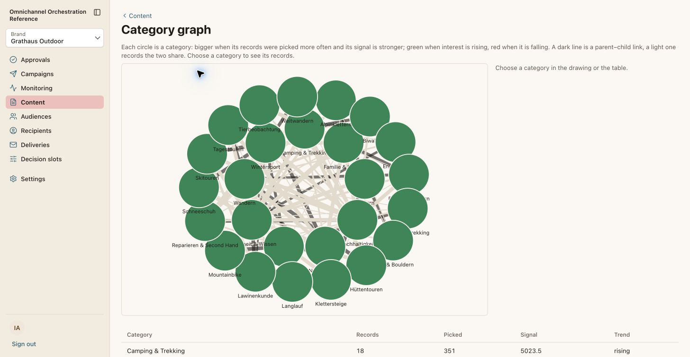

### UX-04 · P1 · Character-only shortcuts cannot be disabled or remapped

**Accessibility — Global keyboard shortcuts**

?, /, p and g-then-letter sequences are active outside text fields. The help dialog offers no off/remap control; the registry explicitly describes shortcuts as not configurable.

**Impact:** Accidental activation from speech input or stray keys. This conflicts with WCAG 2.1.4 for global character-only shortcuts.

**Suggested correction:** Provide a persistent off switch or remapping with a non-character modifier; preserve focused-widget keyboard behavior.

**Reproduce:** Focus a non-input control → ?; review the help. Test g then c and / outside text inputs.

**Source corroboration:** `frontend/src/shortcuts/Shortcuts.tsx:76`.

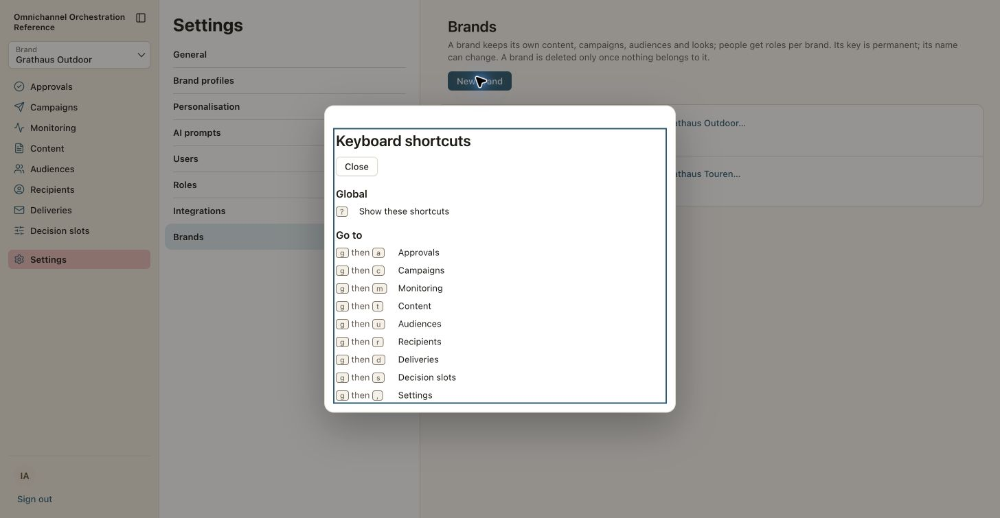

### UX-05 · P2 · Global navigation shortcuts operate behind an open modal

**Defect — Keyboard shortcuts dialog**

Opened shortcut help on Settings → Brands. With Close focused, g then c changed the URL and background to Campaigns while the dialog stayed open.

**Impact:** The modal does not isolate navigation commands; its content can change beneath the user.

**Suggested correction:** Suspend background commands while a modal is open, or make modal navigation an explicit action that closes the dialog and intentionally restores focus.

**Reproduce:** Settings → Brands → ? → focus Close → g then c.

**Source corroboration:** `frontend/src/shortcuts/Shortcuts.tsx:76`.

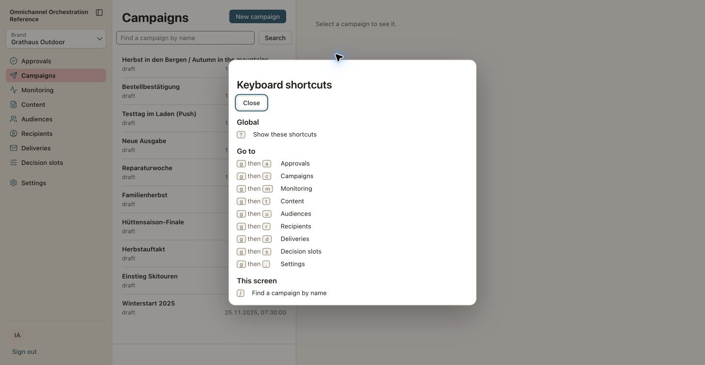

### UX-06 · P2 · Textarea borders use the weak divider color

**Accessibility — Record fields / profile multiline fields**

Body text (long) has a 1 px #e4daca border on white, about 1.38:1 contrast. Single-line fields use the stronger #857a6c border, about 4.20:1. The textarea background is also white, so the boundary is its principal visible affordance.

**Impact:** Multiline editable areas are harder to distinguish, especially with low vision; review against WCAG 1.4.11.

**Suggested correction:** Use the strong field-border token for textareas as for inputs. Keep decorative card separators on the weaker token.

**Reproduce:** Open a record → scroll to Body text (long); compare the surrounding inputs.

**Source corroboration:** `frontend/src/index.css:765`.

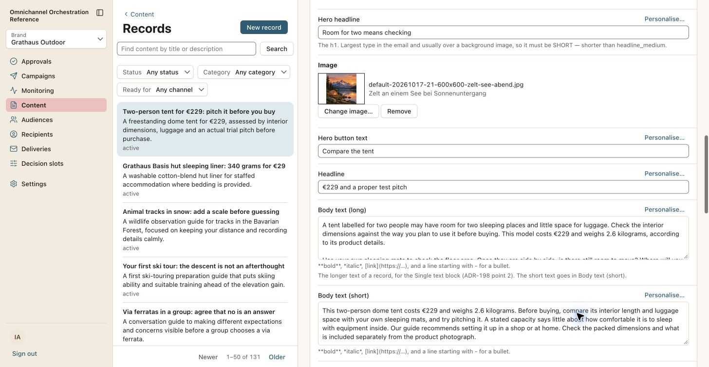

### UX-07 · P2 · Personalisation labels run into token names

**Defect — Personalise menu**

The menu renders “Salutation formal{{salutation_formal}}” with no visual gap. The same happens on phone width.

**Impact:** Labels and machine tokens cannot be scanned independently.

**Suggested correction:** Use a two-column menu row with a real gap; style the token in monospace and allow truncation or wrapping without colliding.

**Reproduce:** In a variant field → Personalise….

**Source corroboration:** `frontend/src/components/EditorFields.tsx:177`.

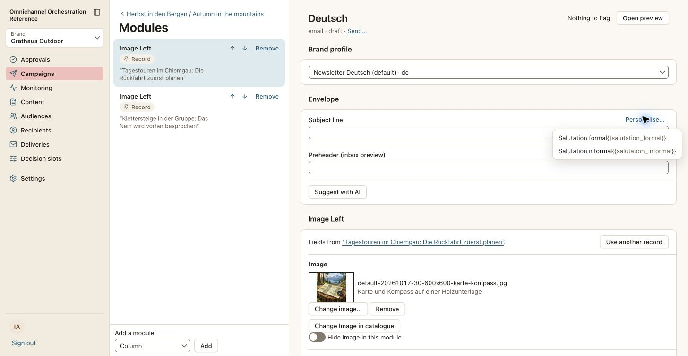

### UX-08 · P2 · Repeated Personalise buttons have identical accessible names

**Accessibility — Record and variant editors**

Every field action is named “Personalise…”. The sampled controls have no field-specific aria-label or aria-describedby association.

**Impact:** A screen-reader button list does not reveal which field each action edits.

**Suggested correction:** Name actions by field, e.g. “Personalise subject line” and “Personalise headline”, while retaining concise visible text.

**Reproduce:** Inspect the editor accessibility tree or navigate among its Personalise buttons.

**Source corroboration:** `frontend/src/components/EditorFields.tsx:173`.

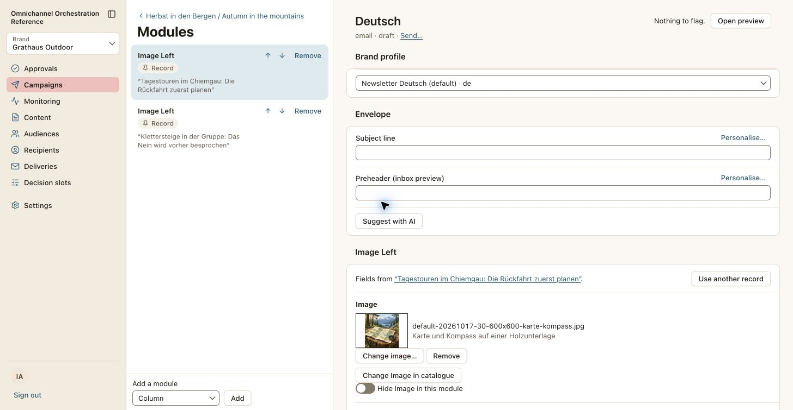

### UX-09 · P2 · Role-removal buttons do not name the role or brand

**Accessibility — Settings / Users / Access**

The two access rows each expose a button named only “Remove”, for Admin on two different brands. Other parts of the platform use names such as “Remove Biwak”.

**Impact:** The consequence of the action is ambiguous when navigating controls by name.

**Suggested correction:** Use “Remove Admin on Grathaus Outdoor” and the equivalent name for each assignment.

**Reproduce:** Settings → Users → Initial admin → inspect Access.

### UX-10 · P2 · Recipient data tables have no column or row headers

**Accessibility — Recipients / detail**

Consent renders channel, purpose, status, source and time as td-only rows. Interests and Consent history follow the same pattern.

**Impact:** Relationships between values are not programmatically identified; “demo” and a timestamp have no announced header context.

**Suggested correction:** Add visible column headings with th/scope, a row header where appropriate, and a concise table caption or accessible label.

**Reproduce:** Recipients → grathaus-1000 → inspect Consent and lower tables.

**Source corroboration:** `frontend/src/screens/RecipientDetail.tsx:42`.

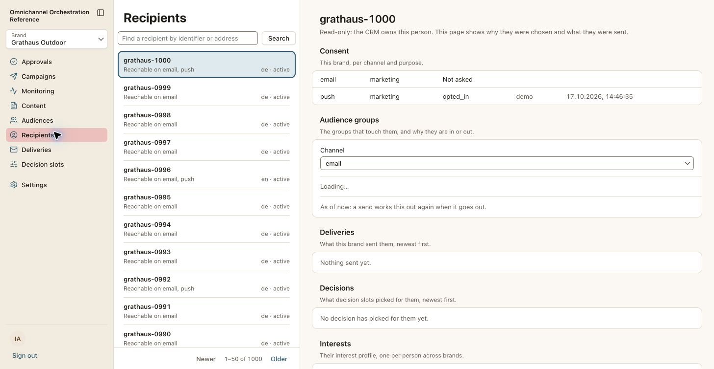

### UX-11 · P2 · General settings facts lose the card content inset

**Defect — Settings / General**

In Sending and AI, label/value rows start at the left card edge while neighboring inputs and buttons start 16 px inside. The AI facts appear as ungrouped lines rather than the fact rows used elsewhere.

**Impact:** The vertical alignment breaks within the same card and weakens label/value grouping.

**Suggested correction:** Render these facts with the shared fact-row component and the same 16 px content inset.

**Reproduce:** Settings → General → compare Sending; scroll to AI.

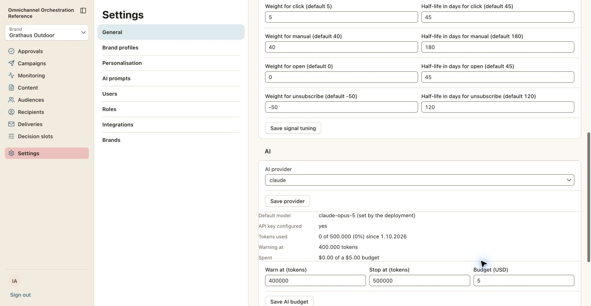

### UX-12 · P2 · Inline action buttons align with labels instead of inputs

**Defect — Category, record and access forms**

The Add button in “Put it under” is level with the label, above the selection field. Duplicate on records, Give in user access, and Issue a key show the same staggered baseline.

**Impact:** Connected controls look unrelated and the horizontal alignment feels unfinished.

**Suggested correction:** Align the button with the input/control bottom edge, accounting for field label height and bottom margins.

**Reproduce:** Categories → Wandern → Put it under. Compare record Duplicate and user Give a role.

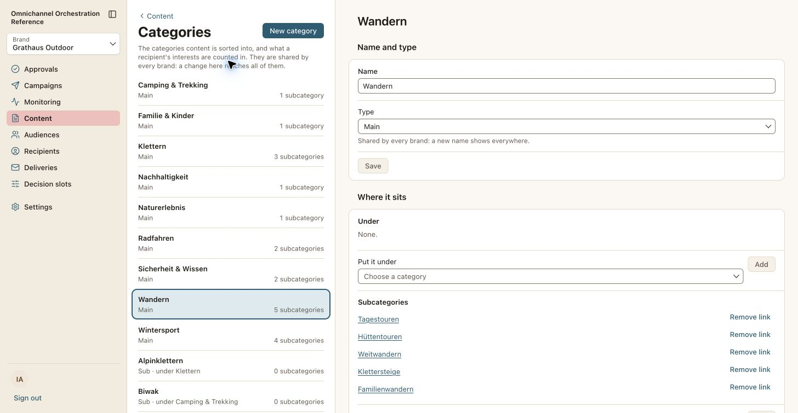

### UX-13 · P3 · Dialog headers and action order vary

**Inconsistency — Modals across the app**

The image picker puts Close below its heading on the left. Preview puts Close in a right-aligned header. Paste people stacks Check and Cancel; the broken creation forms place Create before Cancel, while the standard dialogs put Cancel before Create at the right.

**Impact:** Users must relearn where to dismiss or confirm each dialog.

**Suggested correction:** Adopt shared modal-header and action-footer patterns; use a consistent Cancel → primary-action order.

**Reproduce:** Compare Change image…, Open preview, New record, New category and Paste people.

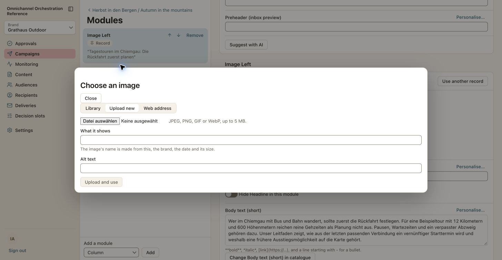

### UX-14 · P2 · Long profile form has its only Save action at the bottom

**Recommendation — Settings / Brand profile**

Save is a normal card near the end of a multi-screen form and scrolls away. There is no persistent save action while editing the earlier sections.

**Impact:** Saving requires a long scroll and the commitment model is easy to miss.

**Suggested correction:** Keep a compact Save/dirty-state action area visible while editing, or provide deliberate section-level saves.

**Reproduce:** Open Newsletter Deutsch and scroll through Legal details, Look, Header and Footer.

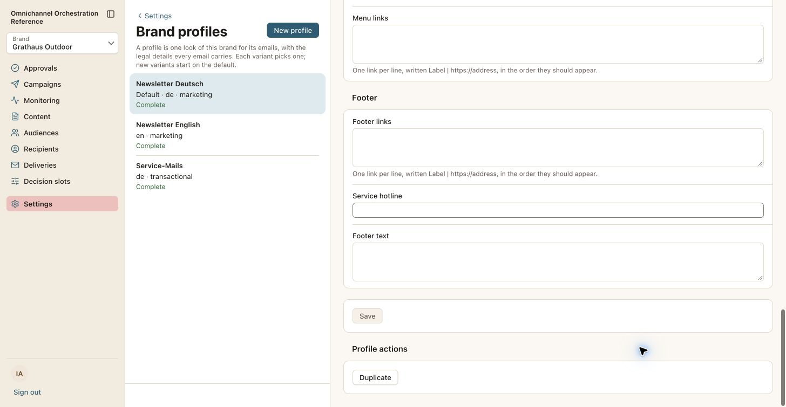

### UX-15 · P2 · Autosave and explicit-save screens do not explain their difference

**Recommendation — Records versus brand profiles and expressions**

Records use blur-based AutosaveField; profile forms have Save; expression Save is enabled even before any edit. At rest, the record screen has no nearby explanation of its blur-save behavior. This is a clarity finding, not a claim that saves fail.

**Impact:** A user can expect Save on an autosaving page or assume a profile edit already persisted.

**Suggested correction:** Show a consistent “Saves when you leave a field” cue or saved/unsaved status, and use predictable dirty-state actions on explicit-save forms.

**Reproduce:** Compare a record detail with Newsletter Deutsch and Salutation formal; no data edit was submitted.

**Source corroboration:** `frontend/src/components/EditorFields.tsx:82`; `frontend/src/screens/Personalisation.tsx:273`.

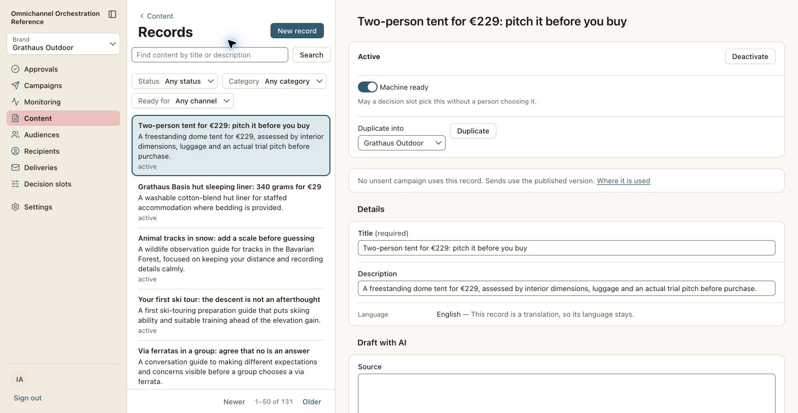

### UX-16 · P2 · ARIA system messages use German inside an English interface

**Inconsistency — Lists, menus and dialogs**

The document declares lang=en and app text is English, but row selection live logs say “ausgewählt” and React Aria dismissal controls are named “Schließen”. Native file-upload controls also follow the German browser locale.

**Impact:** The assistive experience switches language unexpectedly. Native browser wording and app-controlled ARIA localization need to be distinguished.

**Suggested correction:** Set an explicit application locale for React Aria matching the chosen UI language; keep record-content languages intact.

**Reproduce:** Inspect live logs after Enter on a row and the hidden dismissal buttons in modal/menu snapshots.

### UX-17 · P2 · Shortcuts lack a visible entry point and control metadata

**Recommendation — Global navigation and editor actions**

Help is opened with ?, and hints appear while Alt/Ctrl is held. No visible “Keyboard shortcuts” help control was found in the shell. Sampled navigation and preview controls expose no aria-keyshortcuts.

**Impact:** The shortcut system is useful once known but difficult to discover and inspect through assistive tools.

**Suggested correction:** Add a visible, keyboard-reachable shortcuts help action. Expose supported single-key shortcuts through aria-keyshortcuts where valid, and explain sequences in help/description text.

**Reproduce:** Inspect the navigation rail and help; examine Open preview and navigation control attributes.

**Source corroboration:** `frontend/src/shortcuts/Shortcuts.tsx:174`.

### UX-18 · P2 · Scheduled send time has no visible timezone

**Recommendation — Send / Plan the send**

Choosing “At a time” reveals Send at with a local date/time value, but no timezone beside it or in the section help.

**Impact:** A manager cannot confirm how the selected time will be interpreted.

**Suggested correction:** Display the actual scheduling timezone and repeat the resolved date, time and zone before commitment.

**Reproduce:** Send Deutsch → When → At a time. Do not press Plan the send.

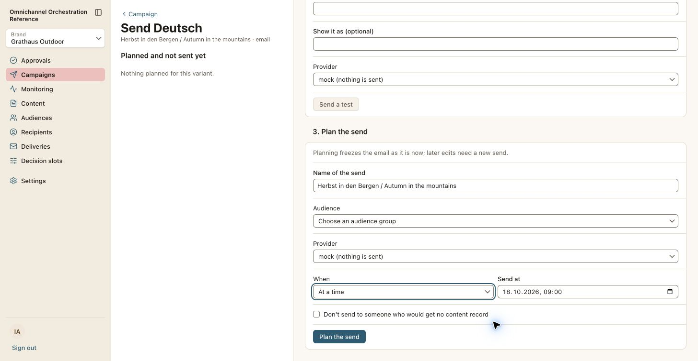

### UX-19 · P2 · Campaign status and delivery status use conflicting-looking labels

**Recommendation — Campaigns versus Monitoring**

Campaigns shows Familienherbst, Hüttensaison-Finale and others as “draft”; Monitoring shows those same campaigns as “Sent”. These can represent distinct states, but the campaign list does not explain that distinction.

**Impact:** The same campaign appears unfinished in one section and sent in another.

**Suggested correction:** Label the states explicitly, e.g. editing status versus latest delivery outcome, or show both. Confirm intended semantics before changing backend status logic.

**Reproduce:** Compare Campaigns and Monitoring for Familienherbst.

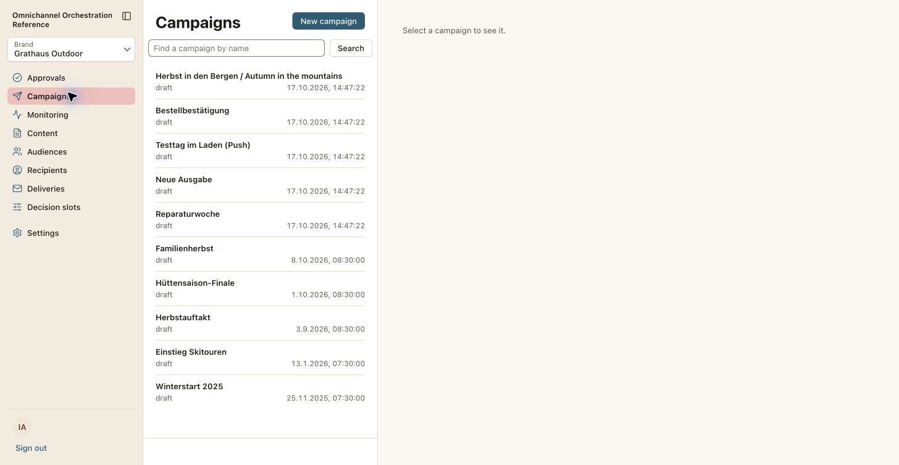

### UX-20 · P2 · Manager-facing content exposes internal identifiers and excessive precision

**Recommendation — Decision slots, archived messages and record help**

Decision explanations contain category_ids, recipient_top_score and long floating-point formulas. Other screens expose content_recommendation, list_unsubscribe, opted_in, headline_medium and an ADR number in field help.

**Impact:** Routine users have to translate implementation terms to understand the result.

**Suggested correction:** Lead with human-readable strategy, category and status labels; round displayed scores; retain exact machine data in an optional technical-details disclosure.

**Reproduce:** Decision slots → Familienherbst slot → scroll to Reasons given; compare record field help.

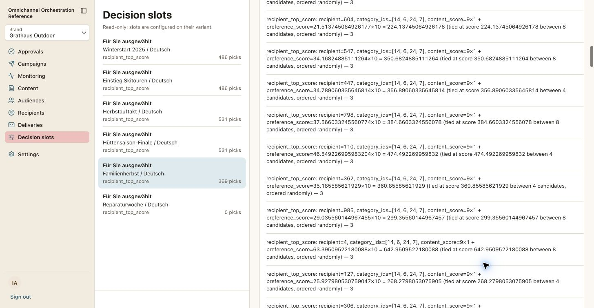

### UX-21 · P2 · Push preview displays raw fields instead of a notification

**Recommendation — Push / Preview**

The main preview shows push_title, push_body, push_image_url and push_link as a definition list. The image is a URL rather than a visible notification image.

**Impact:** Managers cannot assess notification hierarchy, image composition or likely truncation.

**Suggested correction:** Provide a clearly labelled representative notification preview, with the raw payload available as secondary details. Do not imply exact rendering across every device.

**Reproduce:** Open Testtag im Laden (Push) → Edit Push → Open preview.

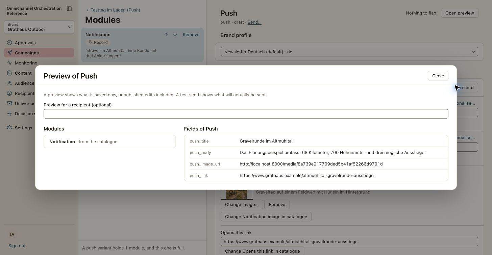

### UX-22 · P3 · Search and filters do not share the list title indent

**Inconsistency — Campaigns, Records and Approvals**

Titles and row text begin at x=252 while search/filter boundaries begin at x=240. Decision history similarly offsets the filters 12 px left of its title and table text.

**Impact:** The left edge zigzags, despite the handoff’s one-indent-per-column rule.

**Suggested correction:** Choose a consistent content alignment for list headers, search and filters; distinguish control borders from text padding deliberately.

**Reproduce:** Compare Records heading, search and filters; then Decision history.

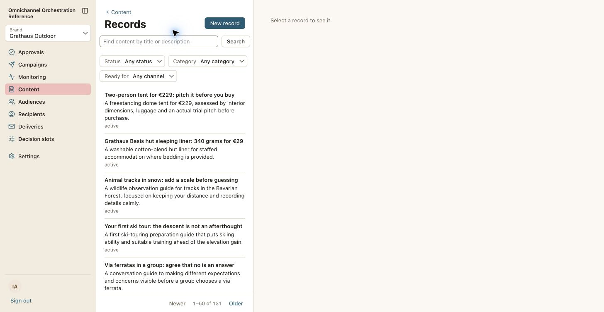

### UX-23 · P3 · Audience header places New on a separate row

**Inconsistency — Audiences / list**

New audience and Suggest from campaign sit below the heading; Campaigns and Records place the primary New action beside the heading.

**Impact:** Header height and the search position vary between otherwise equivalent list screens.

**Suggested correction:** Keep the primary New action on the title row and place Suggest as a secondary action using a consistent overflow or secondary row.

**Reproduce:** Compare Audiences with Campaigns or Records.

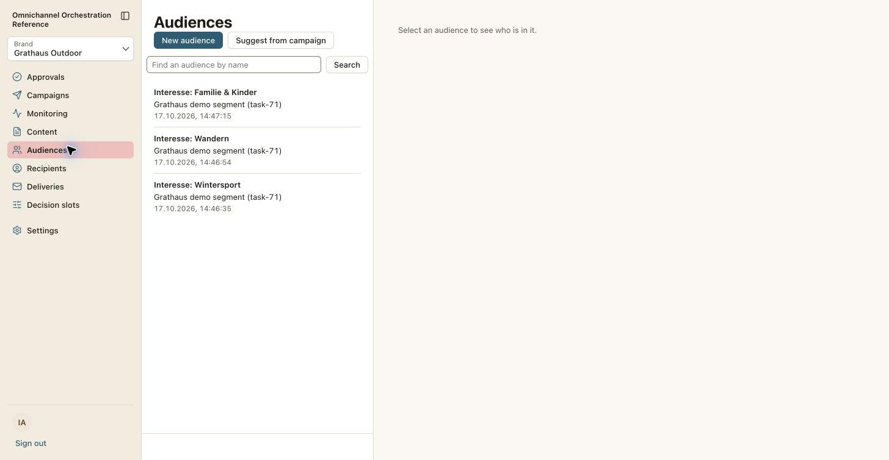

### UX-24 · P3 · Upload control falls back to a different visual system

**Inconsistency — Image picker / Upload new**

The raw file input shows the browser’s square “Datei auswählen” control next to styled English form fields.

**Impact:** Upload feels like a different product surface, especially next to the segmented tabs.

**Suggested correction:** Use a styled accessible file-picker trigger while retaining the native chooser, selected filename and supported-file help. Browser-native chooser language can remain browser-controlled.

**Reproduce:** Change image… → Upload new.

### UX-25 · P3 · Brand rename fields are unnecessarily narrow

**Recommendation — Settings / Brands**

Brand-name inputs remain around 164 px wide in a card with ample unused space; Rename and Delete sit above the field baseline. Other detail editors stretch ordinary text fields.

**Impact:** Long names require horizontal text scrolling while most of the card remains empty.

**Suggested correction:** Use a consistent responsive form row with a flexible name field and aligned actions.

**Reproduce:** Settings → Brands.

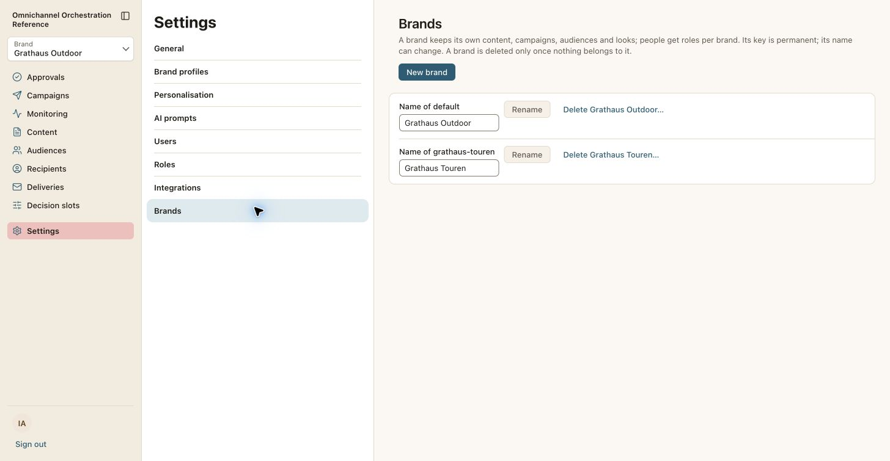

### UX-26 · P2 · Phone layout stacks navigation, module list and detail rather than presenting one work area

**Recommendation — Responsive editor at 390 × 844**

At phone width, global navigation uses about 129 px, then the module list, then the editor starts around y=366. The handoff calls for one column at a time at phone width.

**Impact:** Editing begins well below the top and switching modules requires scrolling past other work areas.

**Suggested correction:** Provide an explicit list/detail transition or compact module picker at phone width, preserving a clear Back control. Treat this as responsive design follow-up, not desktop breakage.

**Reproduce:** Set a 390 × 844 viewport and open the Push variant.

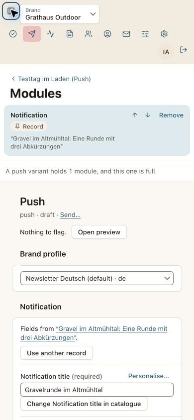

### UX-27 · P2 · Record catalogue mixes languages without showing language

**Recommendation — Content / Records**

English translations and German originals are interleaved. Rows expose title, description and active status but no language badge; current filters contain Status, Category and Ready for only.

**Impact:** It is harder to distinguish an original from a translation or choose the right language for a channel.

**Suggested correction:** Add a concise language/original-translation cue to rows. Consider a language filter after confirming the intended catalogue workflow.

**Reproduce:** Content → Records; compare the English rows followed by German rows.

### UX-28 · P3 · Long body copy is confined to a four-row editor

**Recommendation — Content / record text fields**

The long body field is 90 px tall with 286 px of scrollable content in the sampled English record. It has the same initial row count as the short body.

**Impact:** Reviewing a complete article requires a small nested scrolling area; long and short fields have weak visual differentiation.

**Suggested correction:** Give long-form text a larger initial area or an expand-editor action, while keeping short copy compact.

**Reproduce:** Open the tent record and compare Body text (long) with Body text (short).

**Source corroboration:** `frontend/src/components/EditorFields.tsx:103`.

## Keyboard and ARIA results

| Check | Result |
|---|---|
| Enter on campaign, record, audience, recipient, delivery and Settings rows | Opens the selected detail in sampled lists |
| ArrowDown in Personalise menu | Focuses a menu item |
| ArrowRight in image-source tabs | Selects Upload new |
| Escape from preview, picker, menu and create dialogs | Closes them in sampled flows |
| Tab from Cancel in a populated New record dialog | Wraps to Title |
| Escape from New record | Restores focus to New record trigger |
| Typing `?` inside an unsaved Title | Inserts text; shortcut help does not open |
| `/` outside a dialog | Focuses campaign search |
| `p` in a variant | Opens preview |
| `g` then `c` with shortcut-help Close focused | Navigates behind the open dialog: UX-05 |
| `/` with New campaign Cancel focused | Did not escape the dialog; do not generalize UX-05 into a proven focus-trap failure |
| Current navigation | `aria-current="page"` is present |
| Sampled shortcut controls | No `aria-keyshortcuts`; advisory improvement, UX-17 |
| Document language | `en`; app-controlled React Aria messages included German: UX-16 |

## Contrast measurements and references

Measured textarea boundary: `#e4daca` on `#ffffff` ≈ **1.38:1**; ordinary input boundary: `#857a6c` on white ≈ **4.20:1**. Textarea contrast uses computed live CSS; ratio uses sRGB relative luminance. Decorative separators do not need to be treated like input boundaries. No broad WCAG conformance claim is made.

- [W3C: Character Key Shortcuts, SC 2.1.4](https://www.w3.org/WAI/WCAG22/Understanding/character-key-shortcuts.html): character-only global shortcuts need an off/remap mechanism or focus-limited activation. Sequences are included.
- [W3C: Non-text Contrast, SC 1.4.11](https://www.w3.org/WAI/WCAG22/Understanding/non-text-contrast.html): information needed to identify controls needs sufficient contrast with adjacent colors.
- Repository visual baseline: `docs/design/HANDOFF.md`, especially sections 3 and 4. Its palette and three-column structure are treated as the baseline; open proposals are not assumed to be defects.

## Capture coverage

Screenshots are unaltered captures. The HTML report adds optional numbered outline overlays; it does not alter the evidence images. DOM text files are saved alongside most screenshots. Screenshot 57 records a passing modal-focus probe, not an additional defect.

| Capture | Screen URL |
|---|---|
| [01-approvals](screenshots/01-approvals.jpg) | `http://localhost:5173/manager/approvals` |
| [02-approval-history](screenshots/02-approval-history.jpg) | `http://localhost:5173/manager/approvals/history` |
| [03-campaigns](screenshots/03-campaigns.jpg) | `http://localhost:5173/manager/campaigns` |
| [04-campaign-detail](screenshots/04-campaign-detail.jpg) | `http://localhost:5173/manager/campaigns/12` |
| [05-variant-editor](screenshots/05-variant-editor.jpg) | `http://localhost:5173/manager/campaigns/12/variants/12` |
| [06-preview](screenshots/06-preview.jpg) | `http://localhost:5173/manager/campaigns/12/variants/12` |
| [07-personalise](screenshots/07-personalise.jpg) | `http://localhost:5173/manager/campaigns/12/variants/12` |
| [08-image-picker](screenshots/08-image-picker.jpg) | `http://localhost:5173/manager/campaigns/12/variants/12` |
| [09-image-upload](screenshots/09-image-upload.jpg) | `http://localhost:5173/manager/campaigns/12/variants/12` |
| [10-image-web](screenshots/10-image-web.jpg) | `http://localhost:5173/manager/campaigns/12/variants/12` |
| [11-send](screenshots/11-send.jpg) | `http://localhost:5173/manager/campaigns/12/variants/12/send` |
| [12-monitoring](screenshots/12-monitoring.jpg) | `http://localhost:5173/manager/monitoring` |
| [13-content](screenshots/13-content.jpg) | `http://localhost:5173/manager/content` |
| [14-records](screenshots/14-records.jpg) | `http://localhost:5173/manager/content/records` |
| [15-record-detail](screenshots/15-record-detail.jpg) | `http://localhost:5173/manager/content/156` |
| [16-new-record](screenshots/16-new-record.jpg) | `http://localhost:5173/manager/content/156` |
| [17-categories](screenshots/17-categories.jpg) | `http://localhost:5173/manager/content/categories` |
| [18-category-detail](screenshots/18-category-detail.jpg) | `http://localhost:5173/manager/content/categories/1` |
| [19-new-category](screenshots/19-new-category.jpg) | `http://localhost:5173/manager/content/categories/1` |
| [20-graph](screenshots/20-graph.jpg) | `http://localhost:5173/manager/content/graph` |
| [21-audiences](screenshots/21-audiences.jpg) | `http://localhost:5173/manager/audiences` |
| [22-audience-detail](screenshots/22-audience-detail.jpg) | `http://localhost:5173/manager/audiences/2` |
| [23-new-audience](screenshots/23-new-audience.jpg) | `http://localhost:5173/manager/audiences/2` |
| [24-suggest-audience](screenshots/24-suggest-audience.jpg) | `http://localhost:5173/manager/audiences/2` |
| [25-rule-editor](screenshots/25-rule-editor.jpg) | `http://localhost:5173/manager/audiences/2` |
| [26-paste-people](screenshots/26-paste-people.jpg) | `http://localhost:5173/manager/audiences/2` |
| [27-recipients](screenshots/27-recipients.jpg) | `http://localhost:5173/manager/recipients` |
| [28-recipient-detail](screenshots/28-recipient-detail.jpg) | `http://localhost:5173/manager/recipients/1000` |
| [29-deliveries](screenshots/29-deliveries.jpg) | `http://localhost:5173/manager/deliveries` |
| [30-delivery-detail](screenshots/30-delivery-detail.jpg) | `http://localhost:5173/manager/deliveries/5` |
| [31-as-sent](screenshots/31-as-sent.jpg) | `http://localhost:5173/manager/deliveries/5/executions/801` |
| [32-slots](screenshots/32-slots.jpg) | `http://localhost:5173/manager/decision-slots` |
| [33-slot-detail](screenshots/33-slot-detail.jpg) | `http://localhost:5173/manager/decision-slots/5` |
| [34-settings](screenshots/34-settings.jpg) | `http://localhost:5173/manager/settings` |
| [35-profiles](screenshots/35-profiles.jpg) | `http://localhost:5173/manager/settings/brand-profiles` |
| [36-profile-detail](screenshots/36-profile-detail.jpg) | `http://localhost:5173/manager/settings/brand-profiles/1` |
| [37-new-profile](screenshots/37-new-profile.jpg) | `http://localhost:5173/manager/settings/brand-profiles/1` |
| [38-personalisation](screenshots/38-personalisation.jpg) | `http://localhost:5173/manager/settings/personalisation` |
| [39-expression-detail](screenshots/39-expression-detail.jpg) | `http://localhost:5173/manager/settings/personalisation/2` |
| [40-new-expression](screenshots/40-new-expression.jpg) | `http://localhost:5173/manager/settings/personalisation/2` |
| [41-ai-prompts](screenshots/41-ai-prompts.jpg) | `http://localhost:5173/manager/settings/ai-prompts` |
| [42-ai-prompt-detail](screenshots/42-ai-prompt-detail.jpg) | `http://localhost:5173/manager/settings/ai-prompts/content_draft` |
| [43-users](screenshots/43-users.jpg) | `http://localhost:5173/manager/settings/users` |
| [44-user-detail](screenshots/44-user-detail.jpg) | `http://localhost:5173/manager/settings/users/95` |
| [45-new-user](screenshots/45-new-user.jpg) | `http://localhost:5173/manager/settings/users/95` |
| [46-roles](screenshots/46-roles.jpg) | `http://localhost:5173/manager/settings/roles` |
| [47-role-detail](screenshots/47-role-detail.jpg) | `http://localhost:5173/manager/settings/roles/2` |
| [48-new-role](screenshots/48-new-role.jpg) | `http://localhost:5173/manager/settings/roles/2` |
| [49-integrations](screenshots/49-integrations.jpg) | `http://localhost:5173/manager/settings/integrations` |
| [50-integration-detail](screenshots/50-integration-detail.jpg) | `http://localhost:5173/manager/settings/integrations/1947` |
| [51-new-integration](screenshots/51-new-integration.jpg) | `http://localhost:5173/manager/settings/integrations/1947` |
| [52-brands](screenshots/52-brands.jpg) | `http://localhost:5173/manager/settings/brands` |
| [53-new-brand](screenshots/53-new-brand.jpg) | `http://localhost:5173/manager/settings/brands` |
| [54-shortcuts](screenshots/54-shortcuts.jpg) | `http://localhost:5173/manager/settings/brands` |
| [55-shortcuts-background-navigation](screenshots/55-shortcuts-background-navigation.jpg) | `http://localhost:5173/manager/campaigns` |
| [56-new-campaign](screenshots/56-new-campaign.jpg) | `http://localhost:5173/manager/campaigns` |
| [57-modal-search-focus](screenshots/57-modal-search-focus.jpg) | `http://localhost:5173/manager/campaigns` |
| [58-push-editor](screenshots/58-push-editor.jpg) | `http://localhost:5173/manager/campaigns/9/variants/9` |
| [59-record-binding](screenshots/59-record-binding.jpg) | `http://localhost:5173/manager/campaigns/9/variants/9` |
| [60-push-preview](screenshots/60-push-preview.jpg) | `http://localhost:5173/manager/campaigns/9/variants/9` |
| [61-collapsed-navigation](screenshots/61-collapsed-navigation.jpg) | `http://localhost:5173/manager/campaigns/9/variants/9` |
| [62-tablet-editor](screenshots/62-tablet-editor.jpg) | `http://localhost:5173/manager/campaigns/9/variants/9` |
| [63-phone-editor](screenshots/63-phone-editor.jpg) | `http://localhost:5173/manager/campaigns/9/variants/9` |
| [64-phone-personalise](screenshots/64-phone-personalise.jpg) | `http://localhost:5173/manager/campaigns/9/variants/9` |
| [65-phone-image-picker](screenshots/65-phone-image-picker.jpg) | `http://localhost:5173/manager/campaigns/9/variants/9` |
| [66-general-lower](screenshots/66-general-lower.jpg) | `http://localhost:5173/manager/settings` |
| [67-profile-look](screenshots/67-profile-look.jpg) | `http://localhost:5173/manager/settings/brand-profiles/1` |
| [68-profile-footer](screenshots/68-profile-footer.jpg) | `http://localhost:5173/manager/settings/brand-profiles/1` |
| [69-record-fields](screenshots/69-record-fields.jpg) | `http://localhost:5173/manager/content/156` |
| [70-record-bottom](screenshots/70-record-bottom.jpg) | `http://localhost:5173/manager/content/156` |
| [71-send-plan](screenshots/71-send-plan.jpg) | `http://localhost:5173/manager/campaigns/12/variants/12/send` |
| [72-send-schedule](screenshots/72-send-schedule.jpg) | `http://localhost:5173/manager/campaigns/12/variants/12/send` |
| [73-slot-picks](screenshots/73-slot-picks.jpg) | `http://localhost:5173/manager/decision-slots/5` |
| [74-slot-reasons](screenshots/74-slot-reasons.jpg) | `http://localhost:5173/manager/decision-slots/5` |
| [75-brand-menu](screenshots/75-brand-menu.jpg) | `http://localhost:5173/manager/decision-slots/5` |
